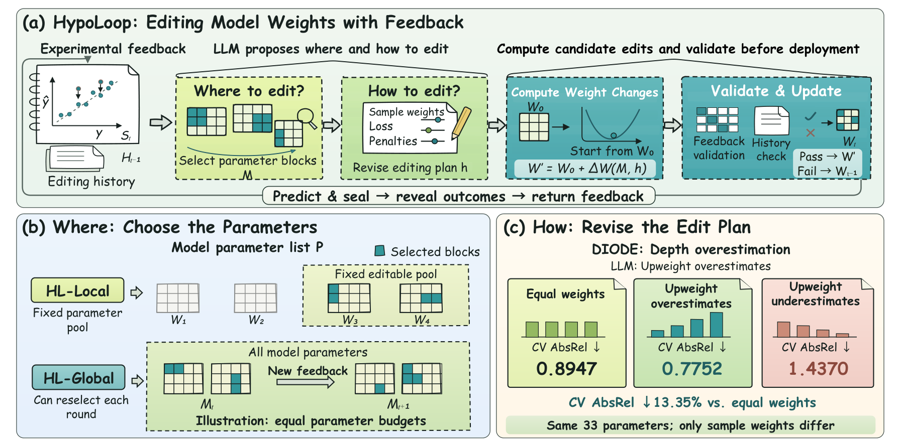
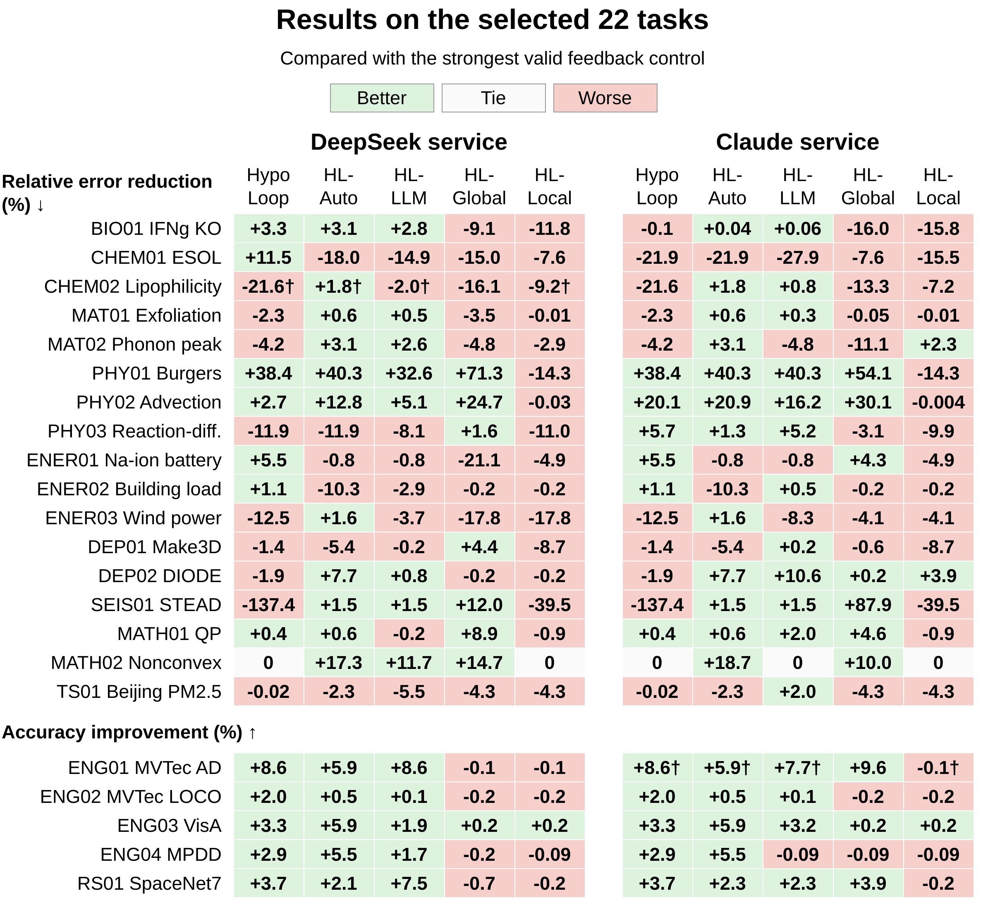
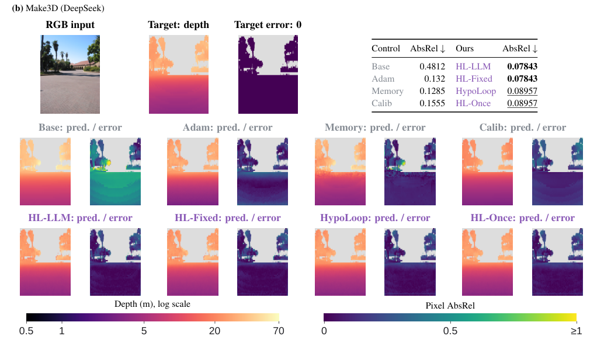
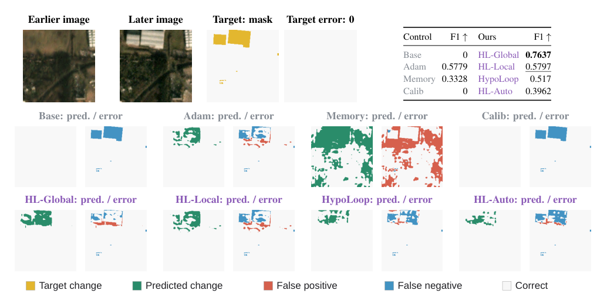

<h1 align="center">🔬 HypoLoop</h1>
<h3 align="center">Revising Weight-Editing Plans from Scientific Feedback</h3>

<b>English</b> · <a href="README.zh-CN.md">简体中文</a>

  
  
  
  
  

<b>Python 3.10+ · PyTorch · Native weight editing · DeepSeek & Claude</b>

  <a href="#results">🏆 Results</a> ·
  <a href="#try-it">⚡ Try it</a> ·
  <a href="#how-it-works">⚙️ Method</a> ·
  <a href="#cases">🖼️ Cases</a> ·
  <a href="#tasks">🌐 Tasks & models</a> ·
  <a href="#repository-map">🗂️ Code map</a> ·
  <a href="#citation">📚 Citation</a>

**Model weights & feedback data** · Download selected paper checkpoints and registered feedback data. [Hugging Face](https://huggingface.co/Amanda1998/HypoLoop) · [Loading guide](docs/HUGGING_FACE.md)

💡 **Let scientific feedback reshape the next weight update.**
HypoLoop turns returned experiments into executable editing plans. An LLM
reconsiders **where to edit** the original model and **how to fit** its correction;
native optimization computes the weight patch, and feedback validation selects
the predictor deployed for the next batch.

> **Companion project.** [WeightLoop](https://github.com/limengran98/WeightLoop) constructs a reusable editing program once and uses new experimental measurements to recompute native weight updates.

The package brings together the native HL-Global loop, reusable local and
linearized editing policies, feedback controls, and the paper's complete result tables.

## 🏆 Results across 22 scientific tasks

| Study | Comparison | Result |
| :--- | :--- | :--- |
| 🌊 **Burgers · HL-Global** | Strongest feedback control | Error **↓71.34% / ↓54.12%**, DeepSeek / Claude |
| 🧭 **Burgers · Where** | Fixed vs dynamic locations, matched coordinate budget | Error **↓58.80% / ↓47.72%**, DeepSeek / Claude |
| 🎯 **DIODE · How** | Uniform vs positive-residual weighting, same 33 coordinates | Internal CV AbsRel **↓13.35%** |
| 🔁 **DIODE · plan revision** | Fixed initial plan vs revised plans, continued fitting in both | Final AbsRel **↓10.59%**, Claude |
| 🌍 **SpaceNet7 · HL-Global** | Same-feedback Adam | Full-split F1 **+3.93 points**, Claude |
| 🌋 **STEAD · HL-Global** | Strongest feedback control | Arrival-time MAE **↓87.92%**, Claude |

📄 **[arXiv](https://arxiv.org/abs/2611.23718)** · **[Paper PDF](https://arxiv.org/pdf/2611.23718)** · **[Supplement](https://arxiv.org/pdf/2611.23718#page=12)** 
📊 **[Table 1: improvements](results/table1.csv)** · **[Table 2: native metrics](results/table2.csv)** · **[Where](results/where.csv)** · **[How](results/how.csv)**

The tables cover **22 tasks × 2 services × 11 methods**, with **484 native metric
values**. The strongest same-feedback control is selected from Adam, Memory,
and Calib for each task and service. Error changes are relative percentages;
AP/F1 changes are percentage points. All seven HypoLoop family configurations
and the four controls appear in the released tables.

† denotes supplementary evaluations included in the released tables.

## ⚡ Try it: feedback to native weights

The CPU walkthrough needs no API key or dataset download.

~~~bash
git clone https://github.com/limengran98/HypoLoop.git
cd HypoLoop
python -m pip install -e .
python examples/feedback_demo.py --output outputs/demo
~~~

The synthetic walkthrough runs two editing-plan stages, validates **12
candidates**, saves a complete native checkpoint, and verifies its reloaded
predictions. Its report includes:

~~~text
"native_reload_max_error": 0.0
"candidates": 12
~~~

Use the original model and data through the [native task interface](docs/NATIVE_TASKS.md):

~~~bash
python -m hypoloop.cli --bundle scientific_task --provider both --output outputs/task
~~~

Service endpoints and model identifiers are configured in [.env.example](.env.example).
Both services use the same model and feedback interface; their requests, replies,
and accepted plans are recorded.

## ⚙️ Where to edit, and how to edit

1. **Observe.** Summarize errors on returned measurements and the previous edits' validation.
2. **Localize.** Select native tensors or coordinate blocks from the full parameter inventory.
3. **Revise.** Specify residual weighting, loss, regularization, reference preservation, and patch scale.
4. **Fit and validate.** Optimize through the original nonlinear network and select with grouped or temporal CV.
5. **Deploy and repeat.** Reload the native checkpoint, seal the next predictions, and use returned outcomes to revise the next plan.

~~~math
(M_t,h_t)=\mathrm{Plan}(f_{W_0},S_t,H_t),\qquad
\widehat z_t=\mathrm{Fit}(M_t,h_t;W_0,S_t),\qquad
W_t=W_0+\eta_t D_{M_t}\widehat z_t .
~~~

Here, <code>M</code> selects native coordinates, <code>h</code> defines the fitting
objective, <code>S</code> contains returned observations, and <code>H</code>
contains the editing history. Each accepted edit is a total patch around the
same original checkpoint.

| HypoLoop family | Editing configuration |
| :--- | :--- |
| **HypoLoop** | Registered local editing with a shared numerical candidate policy |
| **HL-Auto** | Numerical adaptation of the fitting specification |
| **HL-LLM** | API-guided revision of the fitting plan |
| **HL-Fixed** | Initial plans retained while weights continue to update |
| **HL-Once** | One initial weight update |
| **HL-Local** | Fixed API-selected native parameter pool |
| **HL-Global** | Full-inventory native localization and plan revision |

Controls: **Base** retains the initial predictor; **Adam** updates a fixed local
pool; **Memory** interpolates feedback residuals; **Calib** fits output scale and offset.

📘 [Method and mathematics](docs/METHOD.md) · [Task integration](docs/NATIVE_TASKS.md)

## 🖼️ Native corrections you can see

### Outdoor depth · Make3D

An edited native depth predictor improves the displayed image's AbsRel from
**0.1285** for Memory to **0.0784** for HL-LLM, a **38.98% reduction**. Prediction
and error maps share the paper's display scales.

### Building changes · SpaceNet7

With Claude, HL-Global raises full-split F1 from **0.2507 to 0.2899**.
The displayed region improves from **0.5779 to 0.7637**; false-positive and
false-negative maps show the spatial correction.

## 🌐 Scientific tasks and original models

The paper covers biology, chemistry, materials, physical dynamics, energy,
depth, seismology, constrained optimization, time series, industrial inspection,
and remote sensing.

**[Browse all 22 tasks, dataset links, original model code, and citations →](docs/DATASETS.md)**

| Domain | Tasks | Original predictors |
| :--- | :--- | :--- |
| Biology | IFNg knockout | GEARS |
| Chemistry | ESOL, Lipophilicity | Uni-Mol |
| Materials | Exfoliation energy, Phonon peak | CGCNN |
| Physics | Burgers, Advection, Reaction-diffusion | FNO1d |
| Energy | Na-ion battery, Building load, Wind power | PBT-L, DLinear |
| Depth | Make3D, DIODE | Metric Depth Anything V2 |
| Seismology | STEAD | PhaseNet |
| Mathematics | Constrained QP, Nonconvex optimization | DC3 |
| Time series | Beijing PM2.5 | NLinear |
| Industrial inspection | MVTec AD, MVTec LOCO, VisA, MPDD | AnomalyCLIP + R |
| Remote sensing | SpaceNet7 | ChangeMamba |

## ✅ Reproduce the tables and check the code

~~~bash
python -m unittest discover -s tests -v
python scripts/reproduce_results.py --output outputs/tables
python scripts/reproduce_cases.py
python scripts/reproduce_cases.py
~~~

The checks cover nonlinear native inference, coordinate budgets, complex and
tied parameters, missing observations, whole-group validation, checkpoint replay,
and prediction sealing. The table script reconstructs all **484** comparisons
and the matched Where studies from complete-precision source values.
The two displayed cases include [prediction and target arrays](results/cases/);
the case script recomputes their **16 image-level scores**.
The two displayed cases include [prediction and target arrays](results/cases/)
for recomputing their 16 single-instance scores.

## 🗂️ Repository map

| Path | Contents |
| :--- | :--- |
| [hypoloop/](hypoloop/) | Native parameter editing, executable plans, API clients, validation, and feedback streams |
| [examples/](examples/) | Runnable CPU walkthrough |
| [configs/](configs/) | Paper task catalog and editing recipe |
| [results/](results/) | Paper tables and Where/How source values |
| [assets/](assets/) | Paper, supplement, overview, and two visual cases |
| [docs/](docs/) | Mathematics, native interfaces, datasets, and model references |
| [tests/](tests/) | Numerical and sequential-protocol checks |
| [references.bib](references.bib) | Dataset, model, and methodological citations |

## 📚 Citation

### HypoLoop

~~~bibtex
@misc{li2026hypoloop,
  title = {{HypoLoop}: Revising Weight-Editing Plans from Scientific Feedback},
  author = {Li, Mengran and Yan, Xichen and Li, Bo and
            Zhang, Chengyang and Xu, Jinfeng and Lin, Zheng and
            Zang, Zelin and Lei, Zhen and Luo, Jiebo and
            Leung, Victor C. M. and Li, Stan Z.},
  year = {2026},
  eprint = {2611.23718},
  archivePrefix = {arXiv},
  primaryClass = {cs.LG},
  doi = {10.48550/arXiv.2611.23718},
  url = {https://arxiv.org/abs/2611.23718}
}
~~~

### WeightLoop

~~~bibtex
@misc{li2026weightloop,
  title = {{WeightLoop}: Weight-Space Programming with Experimental Feedback},
  author = {Li, Mengran and Li, Bo and Zhao, Weijing and
            Zhang, Chengyang and Zhang, Boyu and Xu, Jinfeng and
            Zang, Zelin and Leung, Victor C. M. and Li, Stan Z.},
  year = {2026},
  eprint = {2611.07319},
  archivePrefix = {arXiv},
  primaryClass = {cs.LG},
  doi = {10.48550/arXiv.2611.07319},
  url = {https://arxiv.org/abs/2611.07319}
}
~~~

## ⚖️ License

Original software is released under the [MIT License](LICENSE).
Dataset, backbone, and figure attribution is provided in [NOTICE](NOTICE.md)
and the [task catalog](docs/DATASETS.md).
