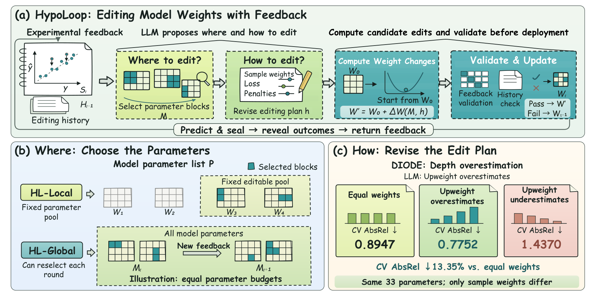
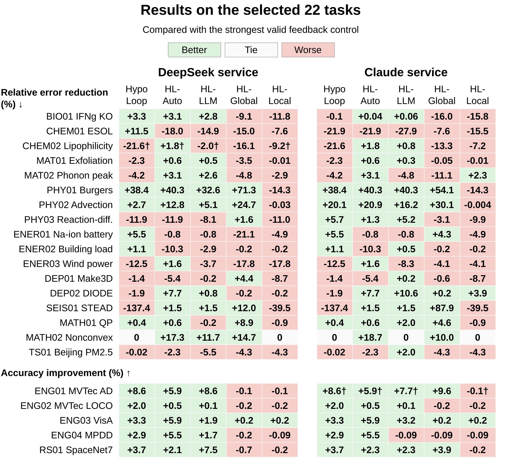
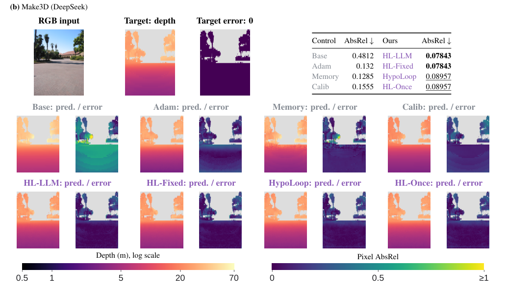
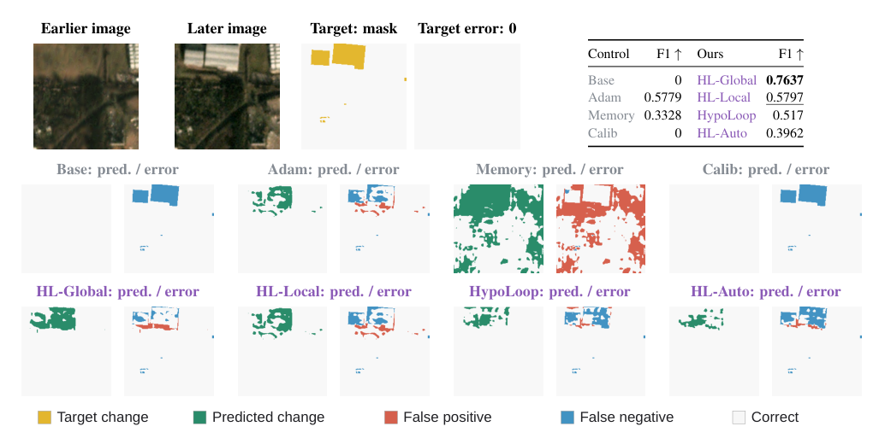

<h1 align="center">🔬 HypoLoop</h1>
<h3 align="center">依据科学反馈修订权重编辑方案</h3>

<a href="README.md">English</a> · <b>简体中文</b>

  
  
  
  
  

**模型与反馈数据** · 论文代表性任务的注册反馈数据、模型权重与编辑补丁集中提供下载。[Hugging Face](https://huggingface.co/Amanda1998/HypoLoop) · [加载说明](docs/HUGGING_FACE.md)

💡 **让新实验反馈决定下一次权重修改的方向与方式。**
HypoLoop动态判断**改哪里、怎样改**：LLM读取模型参数结构、已返回实验的误差和验证记录，
提出可执行编辑方案；数值优化通过原始网络计算权重补丁，验证后部署，再利用后续反馈修订方案。

> **姊妹项目。** [WeightLoop](https://github.com/limengran98/WeightLoop) 一次构建可复用的编辑程序，再用每轮返回的实验测量重新计算原生权重更新。

## 🏆 实验结果

| 实验 | 比较对象 | 已观察到的提升 |
| :--- | :--- | :--- |
| **Burgers · HL-Global** | 最强同反馈对照 | DeepSeek / Claude误差下降 **71.34% / 54.12%** |
| **Burgers · Where** | 同参数预算，固定位置与动态位置 | 误差进一步下降 **58.80% / 47.72%** |
| **DIODE · How** | 相同33坐标，均匀与正残差加权 | 内部CV AbsRel下降 **13.35%** |
| **DIODE · 方案修订** | 首轮方案固定与逐轮修订，双方持续更新权重 | Claude最终AbsRel下降 **10.59%** |
| **SpaceNet7 · HL-Global** | 同反馈Adam | Claude全评估集F1提高 **3.93个百分点** |
| **STEAD · HL-Global** | 最强同反馈对照 | Claude到时MAE下降 **87.92%** |

[arXiv](https://arxiv.org/abs/2611.23718) · [论文 PDF](https://arxiv.org/pdf/2611.23718) · [附录](https://arxiv.org/pdf/2611.23718#page=12) ·
[表1提升值](results/table1.csv) · [表2真实指标](results/table2.csv)

完整结果覆盖 **22任务 × 2服务 × 11方法，共484个原始指标**。
最强同反馈对照从Adam、Memory、Calib中按任务和服务确定。
误差报告相对降幅；AP/F1报告百分点变化。

## ⚡ 快速开始

CPU示例无需API密钥、GPU或数据集下载：

~~~bash
git clone https://github.com/limengran98/HypoLoop.git
cd HypoLoop
python -m pip install -e .
python examples/feedback_demo.py --output outputs/demo
~~~

这个合成示例执行两阶段方案、12个候选的拟合与验证，保存完整原生权重，并核对重载后的预测。
接入科学任务后，两家API可使用同一接口运行：

~~~bash
python -m hypoloop.cli --bundle scientific_task --provider both --output outputs/task
~~~

服务端点、模型标识与密钥通过[环境变量](.env.example)配置。
[原生模型接入说明](docs/NATIVE_TASKS.md)提供数据、指标与反馈批次接口。

## ⚙️ 方法

1. **观察误差：** 汇总已经返回的反馈及此前编辑的验证结果。
2. **选择位置：** 从原生参数清单选择完整张量或有限坐标块。
3. **修订目标：** 指定误差加权、损失、正则、预测保持要求与补丁缩放。
4. **原生验证：** 通过真实网络拟合，并在分组或时间CV中选择方案。
5. **部署迭代：** 重载权重、封存下一批预测，实验返回后继续修订。

自研谱系包括 **HypoLoop、HL-Auto、HL-LLM、HL-Fixed、HL-Once、HL-Local、HL-Global**；
对照包括 **Base、Adam、Memory、Calib**。名称与论文一致。
[完整数学与代码对应](docs/METHOD.md)。

## 🖼️ 两个视觉案例

### Make3D：户外深度

展示图像的AbsRel由Memory的 **0.1285** 降至HL-LLM的 **0.0784**，下降 **38.98%**。
预测图与误差图采用论文中的统一色标。

### SpaceNet7：建筑变化

Claude下HL-Global的全评估集F1由 **0.2507升至0.2899**；
展示区域由 **0.5779升至0.7637**，误检与漏检图直观呈现修正位置。

## 🌐 数据集与原始模型

**[22项任务的数据集、原始模型、下载入口和论文引用](docs/DATASETS.md)**。
涉及GEARS、Uni-Mol、CGCNN、FNO、PBT、DLinear、Depth Anything V2、
PhaseNet、DC3、NLinear、AnomalyCLIP和ChangeMamba。

## ✅ 检查与复现

~~~bash
python -m unittest discover -s tests -v
python scripts/reproduce_results.py --output outputs/tables
python scripts/reproduce_cases.py
python scripts/reproduce_cases.py
~~~

源代码按 **hypoloop / examples / configs / results / assets / docs / tests** 统一组织。
表格源数据保留完整精度；原始数据集和模型的引用集中在
[references.bib](references.bib)。

## 📚 引用与许可

### HypoLoop

~~~bibtex
@misc{li2026hypoloop,
  title = {{HypoLoop}: Revising Weight-Editing Plans from Scientific Feedback},
  author = {Li, Mengran and Yan, Xichen and Li, Bo and
            Zhang, Chengyang and Xu, Jinfeng and Lin, Zheng and
            Zang, Zelin and Lei, Zhen and Luo, Jiebo and
            Leung, Victor C. M. and Li, Stan Z.},
  year = {2026},
  eprint = {2611.23718},
  archivePrefix = {arXiv},
  primaryClass = {cs.LG},
  doi = {10.48550/arXiv.2611.23718},
  url = {https://arxiv.org/abs/2611.23718}
}
~~~

### WeightLoop

~~~bibtex
@misc{li2026weightloop,
  title = {{WeightLoop}: Weight-Space Programming with Experimental Feedback},
  author = {Li, Mengran and Li, Bo and Zhao, Weijing and
            Zhang, Chengyang and Zhang, Boyu and Xu, Jinfeng and
            Zang, Zelin and Leung, Victor C. M. and Li, Stan Z.},
  year = {2026},
  eprint = {2611.07319},
  archivePrefix = {arXiv},
  primaryClass = {cs.LG},
  doi = {10.48550/arXiv.2611.07319},
  url = {https://arxiv.org/abs/2611.07319}
}
~~~

### 许可

原创软件使用 [MIT 许可](LICENSE)。数据集和底座模型保留各自原始许可，来源见 [NOTICE](NOTICE.md)。
